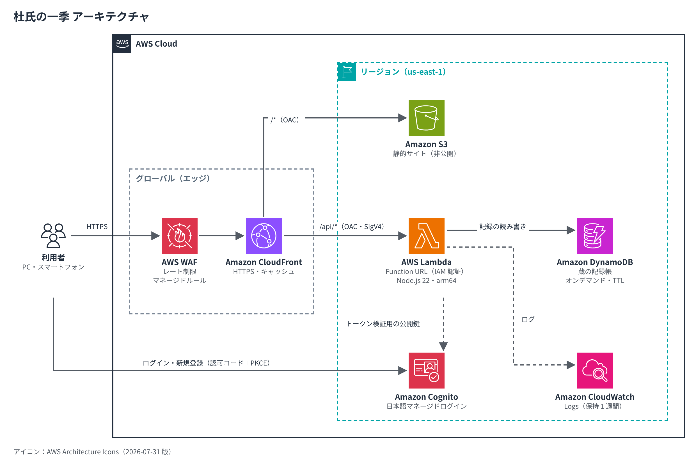
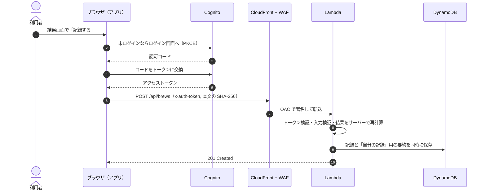
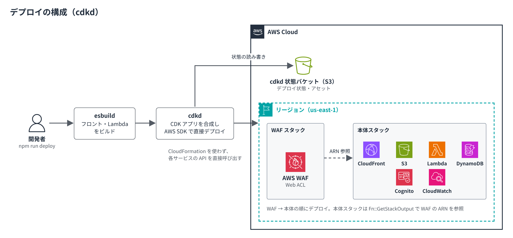

# sakagura-sumirator

JAWS FESTA 2026 前日イベント（酒蔵見学）から着想を得たアプリ開発

## 杜氏の一季 〜酒蔵シミュレーター〜

**杜氏（とうじ）**になって酒造りの判断を体験し、杜氏と蔵人の役割を学べる Web アプリです。

- 蔵元からの注文（鑑評会用の大吟醸、食中酒、燗酒、晩酌酒）と、その年の米・冬の条件が出題されます
- 蔵人の配置 → 原料米 → 精米 → 浸漬 → 製麹 → 酒母 → 酵母 → 醪の温度管理（3 回）→ 上槽 → 火入れ の判断を行います
- 結果として特定名称・日本酒度・酸度・味わい・総合評価と、杜氏としての振り返りが表示されます
- 結果は「蔵の記録帳」（DynamoDB）に保存され、番付で競えます
- 体験・解説・記録帳の閲覧はログイン不要。記録の保存と「自分の記録」にはログイン（メールで自己登録）が必要です

## アプリのこだわり

### 1. 「知識」ではなく「判断」を体験する

杜氏の仕事の本質は、その年ごとに変わる条件を読み、蔵元の注文に合う酒へ仕上げる「判断の連続」です。
そこで、工程を読ませるだけでなく、毎回異なる条件のもとで自分で決めてもらう作りにしました。

- **蔵元の注文 × その年の条件**：鑑評会用の大吟醸、食中酒、燗酒、晩酌酒の 4 つの注文と、米の硬さ（3 段階）・冬の寒さ（3 段階）の組み合わせが毎回変わります。同じ答えが毎年正解にはなりません
- **蔵人からの報告**：「今年の米は硬い」「暖冬で生酛系は雑菌が心配」など、現場の声をヒントに状況を読み取ります
- **蔵人の配置**：ベテランを釜屋・麹屋・酛屋・頭のどこに置くかを最初に決めます。チームを率いる杜氏の役割と、持ち場ごとの仕事を体感できます
- **醪の温度管理**：品温とボーメ（糖分の目安）の推移をグラフで見ながら、3 回にわたってタンクを冷やす・保つ・温めるを決めます

### 2. 結果から「なぜ」を学べる

- **杜氏の振り返り**：浸漬・製麹・酒母・醪・注文への適合について、うまくいった点と失敗の理由を工程ごとに説明します（例：「吸水させすぎて蒸米が柔らかくなり、雑味が出ました」）
- **本物の用語と指標**：限定吸水、突きハゼ・総ハゼ、生酛・山廃、袋吊り、特定名称（純米大吟醸〜本醸造）、日本酒度・酸度・アミノ酸度など、酒蔵見学で耳にする言葉をそのまま使っています
- **解説ページ**：杜氏・蔵人の役割、酒造りの流れ、南部・越後・但馬などの杜氏の流派と、蔵元杜氏・社員杜氏といった現在の姿を紹介します
- 数値は理解のための簡略モデルであることを画面に明記しています

### 3. 遊びとして成り立つバランス

- **評価の考え方**：綺麗さ（造りの確かさ）45% ＋ 注文への適合 45% ＋ 個性 10%。高級な材料を使えば勝てるのではなく、注文に応える力を評価します
- **原価の考え方**：精米歩合を下げる（よく磨く）ほど原価が急に上がるようにしました。そのため「晩酌酒を 35% 精米で造る」ような現実離れした造りは評価されません
- **難易度の確認**：注文と冬の条件の組み合わせごとに 4 万通りの判断をランダムに試し、最高点が 88〜98 点、ランダムな操作の中央値が 34〜69 点になることを確かめています
- **同じ年に再挑戦**：条件は乱数のシード（種）から決まるため、「同じ年でやり直す」や、他の人の記録と同じ年への挑戦ができます
- **番付**：上位は横綱・大関・関脇・小結…と相撲の番付風に表示します

### 4. 公平で信頼できる記録

- 醸造シミュレーションのコード（`shared/engine.ts`）を、ブラウザと Lambda でまったく同じものとして共有しています
- 記録を保存するときは、ブラウザが送った点数を使わず、サーバーが判断内容から計算し直します。点数の改ざんはできません
- 入力値はすべてサーバーで検証し、他の利用者の ID は API の応答に含めません

### 5. 気軽に使えて、安全

- **ログインは保存するときだけ**：体験・解説・記録帳の閲覧はログイン不要です。保存時にログインしても、結果画面はそのまま残ります
- **パスワードを預からない**：ログインと新規登録は Cognito の日本語ログイン画面で行い、パスワードはアプリを通りません
- **多層の防御**：WAF（大量アクセスの遮断・一般的な攻撃の検知）→ CloudFront → OAC（S3 と Lambda は CloudFront 経由でしか呼べない）→ Lambda でのトークン・入力検証
- **スマートフォン対応・ダークモード対応**：キーボード操作や読み上げにも配慮しています

### 6. 低コストで、すぐ作り直せる

- **常時起動のサーバーなし**：API Gateway も使わず、Lambda Function URL を CloudFront の背後に置いています。固定費は WAF の約 8 USD/月のみで、外すこともできます
- **cdkd で高速デプロイ**：CloudFormation を介さず AWS SDK で直接デプロイします。Cognito 一式の追加を含む更新が約 100 秒で終わりました
- **AI-DLC で開発**：要件・設計判断（ADR）・テスト結果を [aidlc-docs/](aidlc-docs/README.md) に残しています

### 7. 酒蔵らしい見た目

- 和紙色の背景、藍と朱の差し色、見出しの明朝体で、酒蔵の落ち着いた雰囲気に寄せています
- 結果は酒瓶のラベル風に表示し、仕込みの進み具合は「仕込み暦」（蔵入り → 原料処理 → 製麹 → 酒母 → 醪 → 上槽 → 火入れ・貯蔵）で示します

## 公開環境

https://d2bkwk7ltvroj5.cloudfront.net （us-east-1 にデプロイ）

## アーキテクチャ



| 経路 | 内容 |
| --- | --- |
| 利用者 → WAF → CloudFront | すべてのアクセスは HTTPS で CloudFront に届き、WAF がレート制限と攻撃の検知を行う |
| CloudFront → S3（`/*`） | 静的サイトと `config.json`。S3 は非公開で、OAC により CloudFront からのみ読める |
| CloudFront → Lambda（`/api/*`） | API。Function URL は IAM 認証で、OAC が SigV4 で署名したリクエストだけを受け付ける |
| Lambda → DynamoDB | 蔵の記録帳の読み書き |
| 利用者 → Cognito | ログイン・新規登録（認可コード + PKCE）。Lambda は Cognito の公開鍵でアクセストークンを検証 |

### 記録を保存するときの流れ



### デプロイの構成



図は AWS 公式の [AWS Architecture Icons](https://aws.amazon.com/architecture/icons/)（2026-07-31 版）で作成しています。
[docs/diagrams/build-diagrams.mjs](docs/diagrams/build-diagrams.mjs) で再生成できます（手順はファイル先頭のコメントを参照）。

## 構成の工夫（サーバーレス・低コスト）

| 工夫 | 内容 |
| --- | --- |
| 常時起動リソースなし | EC2 / NAT / ALB / RDS / API Gateway を使わない |
| API Gateway 不要 | Lambda Function URL を CloudFront の背後に置き、OAC で直接アクセスを禁止 |
| Lambda | arm64・256MB・AWS SDK はランタイム同梱のものを利用（バンドル約 35KB） |
| DynamoDB | オンデマンド課金、GSI なし、1 年で TTL 削除 |
| ログ | 保持期間 1 週間 |
| CloudFront | 価格クラス 200（日本のエッジを含む）、API 応答も数秒〜1 分キャッシュ |
| Cognito | Essentials プラン（月 1 万 MAU まで無料）。日本語のマネージドログイン画面を利用 |
| WAF | レート制限（同一 IP から 5 分間 300 リクエスト超を遮断）＋ AWS マネージドの共通ルール ＋ 既知の不正入力ルール |

### 費用の目安（小規模利用）

| サービス | 月額 |
| --- | --- |
| CloudFront / Lambda / DynamoDB / S3 / Cognito | 無料利用枠内でほぼ 0 USD |
| WAF | 約 8 USD（Web ACL 5 USD ＋ ルール 3 つ × 1 USD）＋ 100 万リクエストあたり 0.6 USD |

WAF が不要な検証環境では `-c waf=false` を付けてデプロイすると WAF を作りません（月額ほぼ 0 USD）。

### 認証のしくみ

- ログイン・新規登録・パスワード再設定は Cognito のマネージドログイン画面で行い、パスワードはこのアプリを通りません
- ブラウザはアクセストークンを `x-auth-token` ヘッダーで API に送り、Lambda が署名・有効期限・発行元を検証します
  （CloudFront OAC が `Authorization` ヘッダーを署名に使うため、独自ヘッダーにしています）
- 確認コードのメールは Cognito 標準の送信機能（1 日 50 通まで）を使います。イベントなどで登録が多い場合は Amazon SES の設定を検討してください

## ディレクトリ

| パス | 内容 |
| --- | --- |
| `shared/engine.ts` | 醸造シミュレーションエンジン（フロントと Lambda で共有） |
| `api/handler.ts` | API（Lambda） |
| `web/` | フロントエンド（TypeScript + esbuild、フレームワークなし） |
| `web/src/auth.ts` | Cognito ログイン（認可コード + PKCE） |
| `lib/sakagura-stack.ts` | 本体スタック（`AWS_REGION` のリージョン）：CloudFront, S3, Lambda, DynamoDB, Cognito |
| `lib/waf-stack.ts` | WAF スタック（us-east-1） |
| `test/` | Vitest のテスト |
| `docs/` | アーキテクチャ図（`images/`）と図の生成スクリプト（`diagrams/`） |
| `aidlc-docs/` | AI-DLC の成果物（要件・設計・ユニット・テスト） |

## 使い方

前提：Node.js 22.12 以上、AWS 認証情報（デプロイするリソースを直接作成できる権限）

```bash
npm ci
npm test              # テスト
npm run dev           # http://localhost:8000 でフロントを確認（ログイン・記録機能はデプロイ後）
```

### cdkd でデプロイ

[cdkd](https://github.com/go-to-k/cdkd)（CDK Direct）は CloudFormation を介さず AWS SDK を直接呼び出して CDK アプリをデプロイするツールです。
cdkd 自体は開発・検証用途向け（本番は通常の `cdk deploy` を推奨）と案内されています。

```bash
export AWS_PROFILE=<profile> AWS_REGION=us-east-1   # 公開環境は us-east-1（未指定時の既定は ap-northeast-1）
aws sts get-caller-identity   # デプロイ先アカウントを確認

npx cdkd bootstrap            # 初回のみ（cdkd の状態保存用 S3 バケットを作成）
npm run diff                  # 変更内容の確認
npm run deploy                # フロントをビルドし、WAF（us-east-1）→ 本体（AWS_REGION）の順にデプロイ
npm run deploy:fast           # 安定化待ちを省略してさらに高速に
```

`SiteUrl` は CloudFront の配信開始後（数分）に表示できるようになります。
公開環境を更新するときは、必ず `AWS_REGION=us-east-1` を指定してください（別のリージョンを指定すると、もう 1 つ別の環境ができます）。
WAF の ARN は `Fn::GetStackOutput` でリージョンをまたいで参照しています（us-east-1 の cdkd 用アセット保存先は初回デプロイ時に自動作成されます）。

| オプション（`-c key=value`） | 既定 | 内容 |
| --- | --- | --- |
| `waf` | `true` | `false` で WAF を作らない |
| `allowLocalhost` | `false` | `true` で `http://localhost:8000` をログイン後の戻り先として許可（ローカルでログインを試す場合。デプロイ済みの `config.json` を `web/public/` に置いて `npm run dev`） |
| `destroyData` | `false` | `true` でスタック削除時に記録とユーザープールも削除 |
| `stackName` | `SakaguraSumirator` | スタック名（WAF スタックは `<stackName>-Waf`） |

### 削除

```bash
npm run destroy
```

記録（DynamoDB テーブル）とユーザー（Cognito ユーザープール）は誤削除を防ぐため既定で残ります。まとめて削除する場合は
`npx cdkd deploy --all -c destroyData=true` で設定を反映してから `npm run destroy` を実行してください。

通常の AWS CDK CLI でも同じアプリをデプロイできます（`npx cdk deploy`、要 `cdk bootstrap`）。

## AI-DLC

本アプリは [AI-DLC](https://github.com/awslabs/aidlc-workflows) の方法論に沿って開発しました。成果物は
[aidlc-docs/](aidlc-docs/README.md) にあります。AI-DLC は Claude Code 用に設定済みのため、
新しいセッションで `/aidlc` から続けて開発できます。
